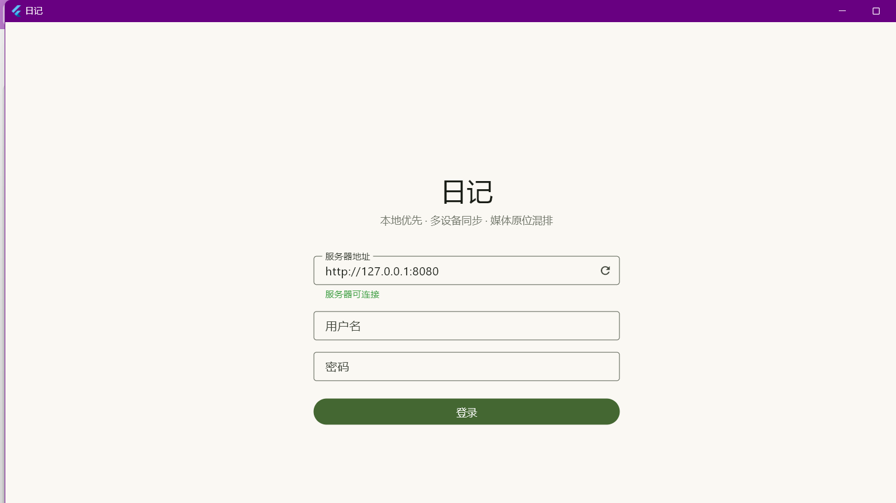
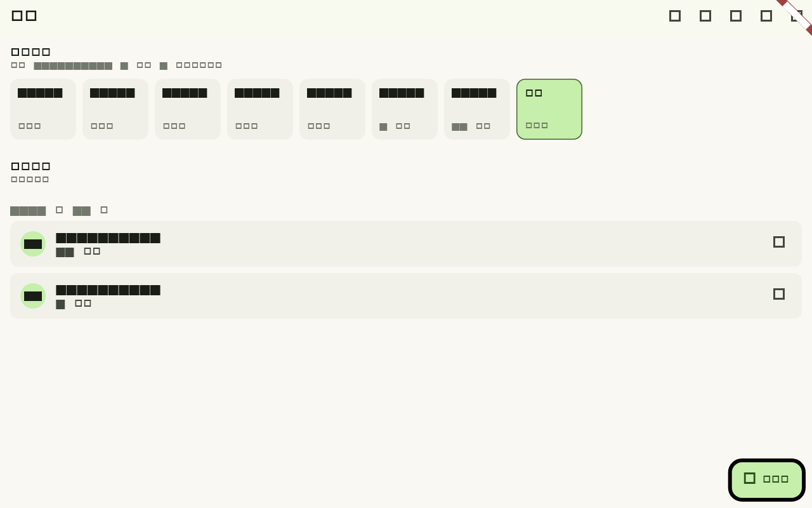
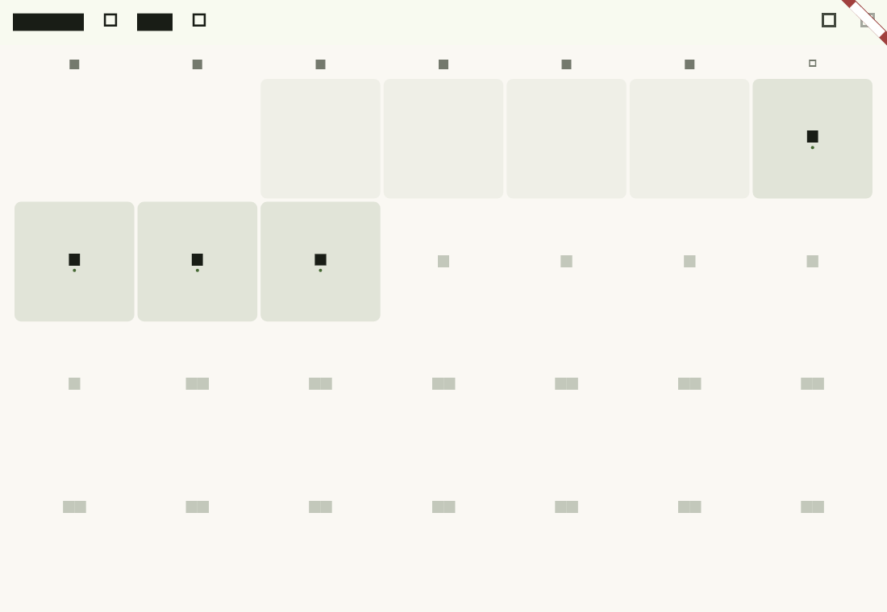
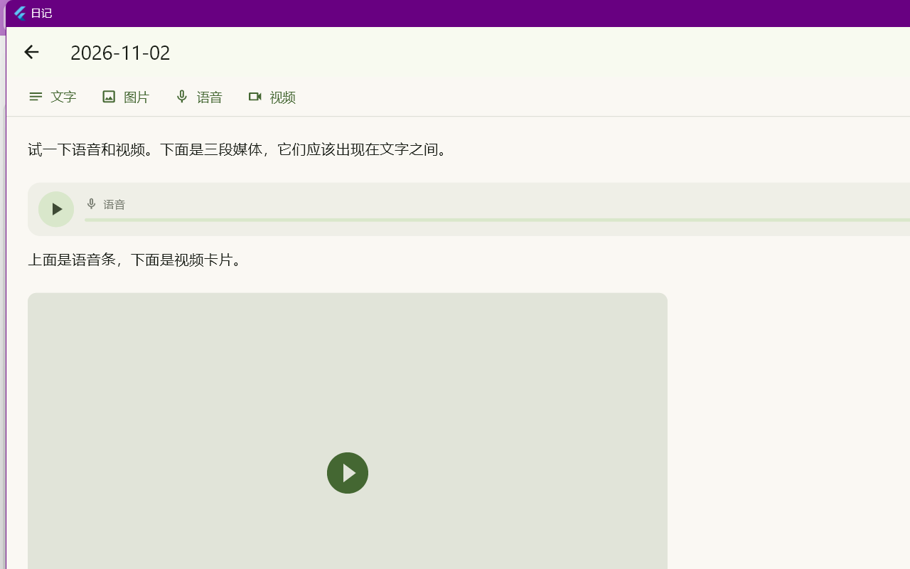
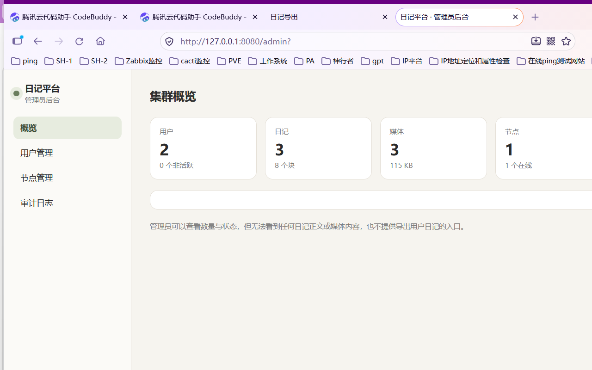

# 界面导览

> 想先知道怎么安装、哪些功能验证过，看 [交付说明](交付说明.md)。

第一次打开这个应用时，你大概会想知道"每个按钮在哪、点了会怎样"。这份文档就是干这个的。

图片都在 `docs/screenshots/` 目录里。

---

## 一、登录页



| 位置 | 元素 | 说明 |
|---|---|---|
| 顶部 | 服务器地址 | 默认 `http://127.0.0.1:8080`。手机端要改成电脑的局域网 IP |
| 地址右侧 | ⟳ 圆形箭头 | 测试服务器是否连得上，下方会显示"服务器可连接" |
| 中部 | 用户名 / 密码 | 管理员或普通账号 |
| 下方 | 忘记密码？用恢复短语找回 | 输 16 个恢复词 + 新密码，不用旧密码也能重置 |
| 最底 | 登录按钮 | — |
| 底部小字 | BUILD-xxx | 版本标记，报问题时告诉我这个编号 |

---

## 二、主页



> 这张图是在测试环境渲染的，中文显示为方块（缺字体），但**布局是真实的**，能看清每个元素的位置。

### 标题栏（右上角，从左到右）

| 图标 | 作用 |
|---|---|
| 📅 日历 | 打开月日历，按日期找日记 |
| 🔍 放大镜 | 全文搜索（关键词不出本机） |
| ⟳ 同步 | 立刻把待推送内容推到服务器 |
| ↻ 刷新 | 重新拉取列表 |
| ⋮ 更多 | 导出四种格式、自检、恢复短语、修改密码、退出登录 |

### 页面内容

| 区块 | 说明 |
|---|---|
| **可写窗口** | 今天 + 往前 7 天。绿色高亮是今天；显示"还没写"或"N 个块" |
| **最近日记** | 按月份分组（"2026 年 11 月"），默认显示 20 篇，底部有「加载更多」 |
| 右下角胶囊按钮 | 「写今天」—— 一步进入今天的编辑器 |

---

## 三、日历页



| 元素 | 说明 |
|---|---|
| ‹ › 箭头 | 上月 / 下月。**不能翻到未来**（需求规定不能写未来） |
| 带底色 + 小圆点的日子 | 这天写过日记 |
| 只有底色没有圆点 | 在可写窗口内，但还没写 |
| 点任意一天 | 直接打开那天的日记。窗口外的日期打开是**只读**的 |
| 底部图例 | 有日记 / 可写 / 只读 三种状态的说明 |

---

## 四、编辑器



> 这张是早期版本的照片，工具栏后来增加了「格式」菜单，其余布局一致。

### 工具栏（从左到右）

| 按钮 | 作用 |
|---|---|
| 格式 | 粗体 / 斜体 / 下划线 / 删除线 / 行内代码 / 标题 / 列表 / 引用 |
| 文字 | 插入新文字块 |
| 图片 | 选取已有图片文件 |
| 语音 | 录音（麦克风） |
| 视频 | 选取已有视频文件 |
| 拍照 / 录像 | **仅安卓显示**，直接调用手机相机 |

### 标题栏

| 图标 | 作用 |
|---|---|
| 👁 眼睛 | 在「编辑」和「预览」之间切换。预览时标记会渲染成真正的排版，勾选框可以点 |
| ☁⤴ 云朵+箭头 | 还有改动没传服务器，点一下立刻同步（平时不用点，退出时会自动同步） |
| ☁✓ 云朵+对勾 | 已经和服务器同步 |
| 右侧状态 | 显示"已保存到本机 HH:MM" / "已同步 HH:MM" / 错误信息 |

> 写长日记时视图会跟着光标走；媒体上传失败会在块上方显示红色「上传失败，点击重试」。

### 块操作

每块左侧有上下箭头（调整顺序）和删除按钮。窗口外的日记只显示内容，不显示这些按钮。

### 看图片 / 视频 / 语音（2026-11-14 更新）

| 操作 | 效果 |
|---|---|
| **点图片本身** | 打开全屏看图（黑色背景、双指缩放、双击放大/还原） |
| **图片右下角「查看原图」** | 全屏加载原图；先显示已缓存的压缩图，原图在后台加载 |
| 原图加载失败 | 页面顶部红条给出原因 + 「重试」；下面的压缩图仍然能看 |
| **播放视频后右上角 ⛶** | 全屏播放：播放/暂停、拖动进度、显示时间 |
| **语音条上点/拖** | 直接跳到对应位置；出错时右侧出现「重试」 |

两点实现细节（也是曾经的问题）：

- 手机横拍的照片，旋转信息写在 EXIF 里；看图前会**真正把像素转正**，所以横屏照片不会再歪着、也不会显得小。
- 全屏看图用的是整屏 `BoxFit.contain` + 可缩放，不再受日记卡片 420px 高度限制，原图有多大就能放多大。

---

## 五、自检页

主页 → ⋮ 更多 → 自检

| 检查项 | 通过标准 |
|---|---|
| 服务器连通 | 显示延迟毫秒数 |
| 登录状态 | 账号状态 active |
| 端到端加密 | 主密钥已在本机 |
| 同步队列 | 没有待推送内容 |
| 本地缓存 | 可读写 |
| PDF 导出字体 | 找到中文字体（缺字体不影响其他三种导出） |

页面顶部会显示**数据目录的实际路径**，Windows 上还有「打开数据目录」按钮。

---

## 六、管理后台

浏览器打开 `http://127.0.0.1:8080/admin`



| 页面 | 能做什么 |
|---|---|
| 概览 | 用户数、日记数、块数、存储占用、节点在线情况 |
| 用户 | 新建 / 禁用 / 重置密码（加密账号会被拒绝，需走客户端） |
| 节点 | 增删、禁用、提升为主、退役、**全量同步**、查看同步进度 |
| 审计 | 所有敏感操作的记录 |

**后台看不到任何日记内容**：接口只返回数量、状态和时间；尝试读用户日记会直接 403。

---

## 七、导出的样子

| 格式 | 效果 |
|---|---|
| [HTML](screenshots/04-导出HTML在浏览器.png) | 自包含文件夹，媒体原位可播放，富文本保留排版 |
| [PDF](screenshots/08-导出PDF在阅读器.png) | 中文字体内嵌，音视频显示为占位符 |
| Markdown | 纯文本 + media 文件夹 |
| ZIP 归档 | manifest.json + 按日期分目录的 entries + 媒体 |

---

## 附：重新生成界面截图

界面截图可以用渲染工具导出，不依赖窗口截图：

```powershell
cd client
flutter test test/render_pages_snapshot.dart
# 图片写到 %TEMP%\riji-calendar.png 等
# 注意：测试可能不会自动退出，出图后按 Ctrl+C 即可
```
